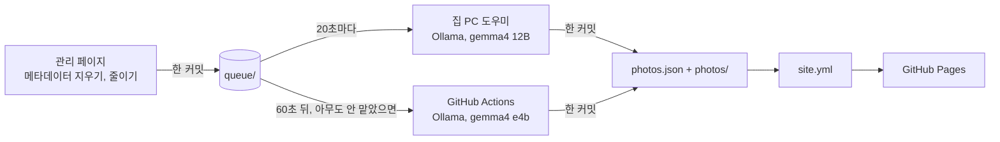
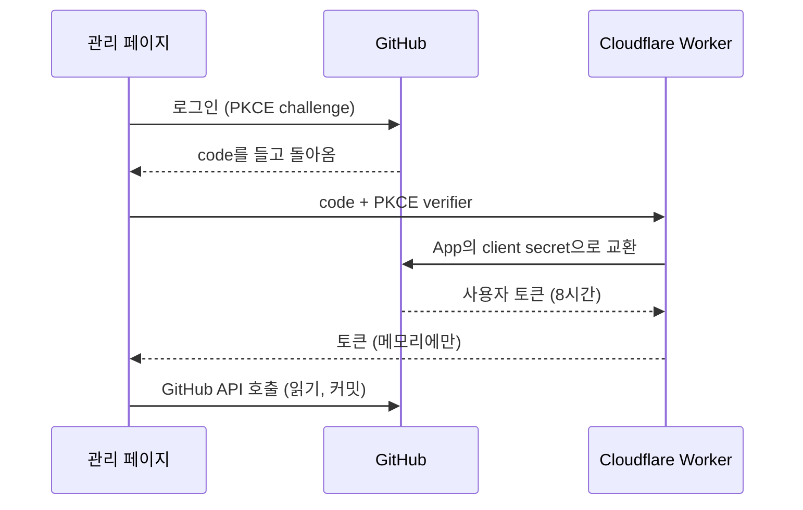

<div align="center">

<picture>
  <source media="(prefers-color-scheme: dark)" srcset=".github/assets/wordmark-dark.png">
  
</picture>

*어두운 전시실처럼 거는 사진들.*

[](https://github.com/HPotty36/nocturne/actions/workflows/site.yml)
[](https://github.com/HPotty36/nocturne/actions/workflows/draft.yml)
[](LICENSE)
[](#라이선스)

**[사이트](https://hpotty36.github.io/nocturne/)** · **[관리 페이지](https://hpotty36.github.io/nocturne/admin/)** · **[English](README.md)**

</div>

<p align="center">
  <picture>
    <source media="(prefers-color-scheme: dark)" srcset=".github/assets/screen-desktop-dark.jpg">
    <source media="(prefers-color-scheme: light)" srcset=".github/assets/screen-desktop-light.jpg">
    
  </picture>
  <picture>
    <source media="(prefers-color-scheme: dark)" srcset=".github/assets/screen-phone-dark.jpg">
    <source media="(prefers-color-scheme: light)" srcset=".github/assets/screen-phone-light.jpg">
    
  </picture>
</p>

Nocturne은 정적 사진 전시 사이트입니다. 폰이나 PC에서 사진을 올리면 Ollama에서 도는 공개 모델이 방을 고르고
제목과 대체 텍스트를 써서 걸고, 사이트는 GitHub Pages에서 다시 만들어집니다. 모든 것이 저장소에 있습니다.
데이터베이스도, 유료 API도 없습니다.

## 특징

- **네 개의 방**: 강, 경기장, 밤, 순간. 방마다 짧은 소개가 있고, 사진마다 아래에 라벨이 붙습니다.
- **꽉 찬 행**: 모든 행이 가로폭을 채우고, 사진은 원래 비율 그대로입니다. 잘리지 않습니다.
- **크게 보기**: 사진을 누르면 크게 봅니다. 방향키, 스와이프, Esc가 됩니다.
- **올리고 잊기**: 폰이나 PC에서 사진을 고르면 AI가 방을 고르고 제목과 대체 텍스트를 써서 바로 게시합니다. 고칠 것은 나중에 고칩니다.
- **유료 API 없음**: 집 PC의 Ollama(gemma4 12B), PC가 꺼져 있으면 GitHub Actions(gemma4 e4b). e4b가 쓴 글은 나중에 12B가 조용히 다시 씁니다.
- **사람이 먼저**: 사람이 고친 제목, 설명, 방은 AI가 다시 바꾸지 않습니다.
- **개인정보**: 메타데이터는 올리기 전에 브라우저에서 지웁니다. GPS는 읽지 않습니다.
- **GitHub 로그인**: GitHub App과 PKCE, 작은 Cloudflare Worker. 토큰은 페이지 메모리에만 있고 어디에도 저장하지 않습니다.
- **밝은 테마와 어두운 테마**: 시스템 설정을 따릅니다. 크게 보기 화면은 둘 다 어둡습니다.

## 동작 방식

관리 페이지가 사진을 줄이고 메타데이터를 지워 `queue/`에 커밋합니다. 먼저 맡은 AI가 방, 제목, 대체 텍스트를
쓰고 한 커밋으로 게시합니다. 그러면 `site.yml` 워크플로가 사이트를 다시 만듭니다.



관리 페이지는 GitHub 계정으로 들어갑니다. 이 저장소에 쓸 수 있는 계정만 들어갈 수 있습니다.



## 기술 스택

| 부분 | 쓰는 것 |
|:---|:---|
| 프런트엔드 | HTML, CSS, JavaScript 그대로. 관리 페이지는 ES 모듈만 씁니다: 프레임워크·번들러 없음, 엄격한 CSP |
| 스크립트 | Python 3 + Pillow: 사이트 빌드, 사진 변환, AI 작업, 집 PC 도우미 |
| AI | Ollama, gemma4 12B(집 PC)와 gemma4 e4b(GitHub Actions) |
| 호스팅 | GitHub Pages, GitHub Actions로 배포 |
| 인증 | GitHub App(사용자 토큰, PKCE) + 코드 교환용 Cloudflare Worker |
| 시험 | Python `unittest`, Node 테스트 러너, 가짜 GitHub 서버 |

## 로컬에서 돌리기

```sh
py -m pip install -r requirements.txt      # 처음 한 번 (Pillow)
py scripts/build.py                        # index.html 만들기 (커밋하지 않음)
py tests/browser/serve.py --port 8000      # http://localhost:8000 미리보기
py -m unittest discover -s tests -v        # Python 시험
node --test "tests/js/*.test.js"           # JS 시험 (Node 24)
```

`py`는 Windows의 Python 실행기입니다. 다른 OS에서는 `python3`을 씁니다. 시험은 네트워크와 Ollama 없이 통과합니다.
진짜 저장소를 건드리지 않고 관리 페이지를 시험하려면 들어 있는 가짜 GitHub 서버에 붙입니다:
[CLAUDE.md](CLAUDE.md#관리-페이지를-컴퓨터에서만-시험하기) 참고.

## 저장소 구성

```
src/          페이지 뼈대, photos.json (방, 제목, 대체 텍스트)
photos/       게시된 사본: thumb/ (1000px), full/ (2400px)
queue/        AI를 기다리는 업로드 (기다리는 동안만 있음)
admin/        관리 페이지: 올리기, 확인, 고치기 (정적 ES 모듈)
auth/         로그인 코드를 토큰으로 바꾸는 Cloudflare Worker
scripts/      빌드, 사진 변환, AI 큐레이터, 대기열 작업, 집 PC 도우미
.github/      워크플로: site.yml (Pages), draft.yml (Actions의 AI); README 그림
tests/        Python·Node 시험, 가짜 GitHub 서버
docs/         설계 문서와 구현 계획
```

구조, 올리는 흐름, 로그인 준비, 디자인 토큰 등 자세한 내용은 [CLAUDE.md](CLAUDE.md)에 있습니다.

## 라이선스

코드는 [MIT 라이선스](LICENSE)로 공개합니다.

`photos/`의 사진(과 `queue/`에 올라온 사진)은 © HPotty36, 모든 권리를 보유합니다. MIT 라이선스에 포함되지
않습니다.
