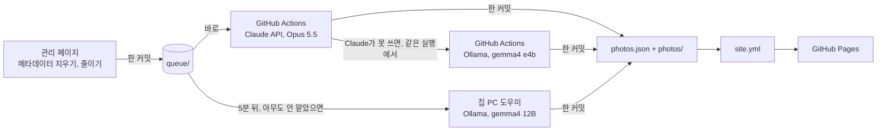
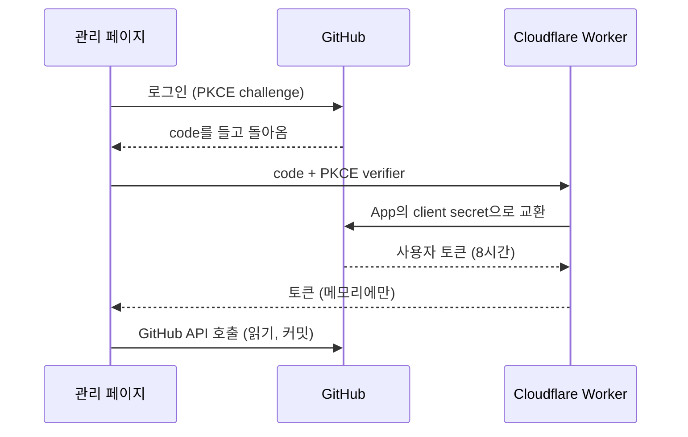

<div align="center">

<picture>
  <source media="(prefers-color-scheme: dark)" srcset=".github/assets/wordmark-dark.png">
  
</picture>

*어두운 전시실처럼 거는 사진들.*

[](https://github.com/HPotty36/nocturne/actions/workflows/site.yml)
[](https://github.com/HPotty36/nocturne/actions/workflows/draft.yml)
[](LICENSE)
[](#라이선스)

**[사이트](https://hpotty36.github.io/nocturne/)** · **[관리 페이지](https://hpotty36.github.io/nocturne/admin/)** · **[English](README.md)**

</div>

<p align="center">
  
  
</p>

Nocturne은 정적 사진 전시 사이트입니다. 폰이나 PC에서 사진을 올리면 Claude가 방을 고르고 제목과 대체 텍스트를
한국어와 영어로 써서 걸고(Claude가 못 쓰면 Ollama에서 도는 공개 모델이 대신 씁니다), 사이트는 GitHub Pages에서
다시 만들어집니다. 모든 것이 저장소에 있습니다. 데이터베이스는 없습니다.

## 특징

- **네 개의 방**: 강, 경기장, 밤, 순간. 방 이름 옆에 사진 수와 기간이 붙고, 사진마다 아래에 "제목, 날짜" 라벨이 붙습니다.
- **꽉 찬 행**: 모든 행이 가로폭을 채우고, 사진은 원래 비율 그대로입니다. 잘리지 않습니다.
- **크게 보기**: 사진을 누르면 검은 화면에 크게 봅니다. 방향키, 스와이프, Esc가 됩니다.
- **검은 방, 글꼴 하나**: 완전한 검정 바탕에 글꼴은 Noto Serif KR 하나만 씁니다. 강조색은 없습니다.
- **한국어와 영어**: 토글로 페이지를 바꾸고, 고른 언어를 기억합니다.
- **설치와 오프라인**: 폰에 설치할 수 있고, 온라인으로 한 번 열고 나면 오프라인에서도 열립니다.
- **공유로 올리기**: 관리 페이지도 따로 설치되고, 안드로이드에서는 사진 앱에서 "Nocturne 관리"로 공유해 올릴 수 있습니다. **올리기**를 누르기 전에는 아무것도 올라가지 않습니다.
- **올리고 잊기**: 폰이나 PC에서 사진을 고르면 AI가 방을 고르고 제목과 대체 텍스트를 한국어와 영어로 써서 바로 게시합니다. 고칠 것은 나중에 두 언어 모두 관리 페이지에서 고칩니다.
- **Claude가 먼저, Ollama는 예비**: GitHub Actions가 Claude API의 Claude Opus 5.5로 씁니다. 비용은 Claude 구독에 딸린 API 크레딧에서 나갑니다. Claude가 못 쓰면 같은 실행에서 Ollama의 gemma4 e4b가 이어 쓰고, Actions가 아예 돌지 못하면 5분 뒤 집 PC(gemma4 12B)가 맡습니다. e4b가 쓴 글은 나중에 12B가 조용히 다시 씁니다.
- **사람이 먼저**: 사람이 고친 제목, 설명, 방은 AI가 다시 바꾸지 않습니다.
- **개인정보**: 메타데이터는 올리기 전에 브라우저에서 지웁니다. GPS는 읽지 않습니다.
- **GitHub 로그인**: GitHub App과 PKCE, 작은 Cloudflare Worker. 토큰은 페이지 메모리에만 있고 어디에도 저장하지 않습니다.

## 동작 방식

관리 페이지가 사진을 줄이고 메타데이터를 지워 `queue/`에 커밋합니다. GitHub Actions가 바로 맡고 Claude가 방,
제목, 대체 텍스트(한국어와 영어)를 씁니다. Claude가 못 쓴 사진은 같은 실행에서 gemma4 e4b가 씁니다. 5분이 지나도
아무도 맡지 않은 사진은 집 PC 도우미가 맡습니다. 초안은 한 커밋으로 게시되고, `site.yml` 워크플로가 사이트를 다시
만듭니다: `index.html`(한국어)과 `en/index.html`(영어), 설치와 오프라인을 위한 웹 매니페스트와 서비스 워커입니다.



관리 페이지는 GitHub 계정으로 들어갑니다. 이 저장소에 쓸 수 있는 계정만 들어갈 수 있습니다.



## 기술 스택

| 부분 | 쓰는 것 |
|:---|:---|
| 프런트엔드 | HTML, CSS, JavaScript 그대로, Google Fonts의 명조 글꼴 하나. 관리 페이지는 ES 모듈만 씁니다: 프레임워크·번들러 없음, 엄격한 CSP |
| 오프라인 | 웹 매니페스트와 서비스 워커(`sw.js`)가 페이지, 썸네일, 대표 사진을 담아 둬서 온라인으로 한 번 연 뒤에는 오프라인에서도 열립니다. 관리 페이지는 따로 설치 정보와 공유로 받은 사진만 담는 작은 서비스 워커가 있고, 화면은 담지 않습니다 |
| 스크립트 | Python 3 + Pillow(Actions에서는 `anthropic` SDK도): 사이트 빌드(`index.html`, `en/index.html`, 매니페스트, `sw.js`를 씁니다), 사진 변환, AI 작업, 집 PC 도우미 |
| AI | Claude API의 Claude Opus 5.5(GitHub Actions). 예비로 Ollama, gemma4 e4b(GitHub Actions)와 gemma4 12B(집 PC) |
| 호스팅 | GitHub Pages, GitHub Actions로 배포 |
| 인증 | GitHub App(사용자 토큰, PKCE) + 코드 교환용 Cloudflare Worker |
| 시험 | Python `unittest`, Node 테스트 러너, 가짜 GitHub 서버 |

## 로컬에서 돌리기

```sh
py -m pip install -r requirements.txt      # 처음 한 번 (Pillow)
py scripts/build.py                        # index.html, en/index.html 만들기 (커밋하지 않음)
py tests/browser/serve.py --port 8000      # http://localhost:8000 미리보기
py -m unittest discover -s tests -v        # Python 시험
node --test "tests/js/*.test.js"           # JS 시험 (Node 24)
```

`py`는 Windows의 Python 실행기입니다. 다른 OS에서는 `python3`을 씁니다. 시험은 네트워크, Ollama, Claude API 키 없이 통과합니다.
진짜 저장소를 건드리지 않고 관리 페이지를 시험하려면 들어 있는 가짜 GitHub 서버에 붙입니다:
[CLAUDE.md](CLAUDE.md#관리-페이지를-컴퓨터에서만-시험하기) 참고.

## 저장소 구성

```
src/          페이지 뼈대, 서비스 워커 틀, photos.json (방, 제목, 대체 텍스트: 한국어와 영어)
icons/        사이트를 설치할 때 쓰는 앱 아이콘
photos/       게시된 사본: thumb/ (1000px), full/ (2400px)
queue/        AI를 기다리는 업로드 (기다리는 동안만 있음)
admin/        관리 페이지: 올리기(또는 공유), 확인, 고치기. 따로 설치 정보, 아이콘, 서비스 워커 (정적 ES 모듈)
auth/         로그인 코드를 토큰으로 바꾸는 Cloudflare Worker
scripts/      빌드, 사진 변환, AI 큐레이터, 대기열 작업, 집 PC 도우미
.github/      워크플로: site.yml (Pages), draft.yml (Actions의 AI); README 그림
tests/        Python·Node 시험, 가짜 GitHub 서버
docs/         설계 문서와 구현 계획
```

구조, 올리는 흐름, 로그인 준비, 디자인 토큰 등 자세한 내용은 [CLAUDE.md](CLAUDE.md)에 있습니다.

## 라이선스

코드는 [MIT 라이선스](LICENSE)로 공개합니다.

`photos/`의 사진(과 `queue/`에 올라온 사진)은 © HPotty36, 모든 권리를 보유합니다([NOTICE](NOTICE.md)). MIT 라이선스에 포함되지
않습니다.
