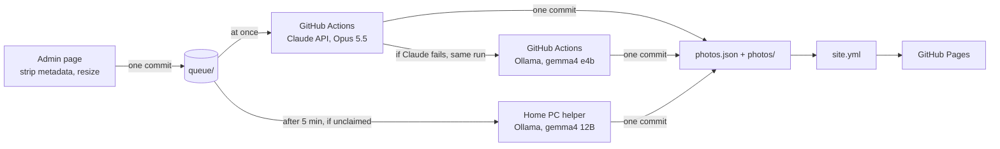
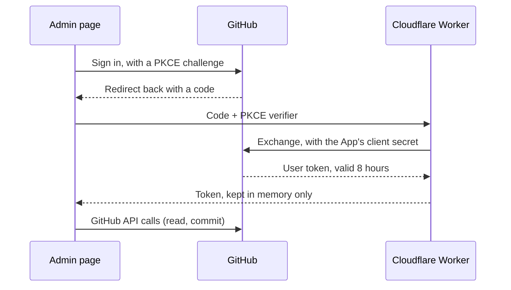

<div align="center">

<picture>
  <source media="(prefers-color-scheme: dark)" srcset=".github/assets/wordmark-dark.png">
  
</picture>

*Photographs hung like a dark exhibition room.*

[](https://github.com/HPotty36/nocturne/actions/workflows/site.yml)
[](https://github.com/HPotty36/nocturne/actions/workflows/draft.yml)
[](LICENSE)
[](#license)

**[Live site](https://hpotty36.github.io/nocturne/)** · **[Admin](https://hpotty36.github.io/nocturne/admin/)** · **[한국어](README.ko.md)**

</div>

<p align="center">
  
  
</p>

Nocturne is a static photo gallery. Upload a photo from a phone or PC, and Claude hangs it in the right room with a
title and alt text in Korean and English, with open models on Ollama as the fallback; the site then rebuilds on
GitHub Pages. The repository holds everything; there is no database.

## Highlights

- **Four rooms**: River, Stadium, Night and Moments. A room's header shows how many prints it holds and the months they cover, and every print has a "title, date" label.
- **Justified rows**: every row fills the width, and prints keep their own aspect ratio. Nothing is cropped.
- **Viewing room**: click any print to see it large on black; arrow keys, swipe and Esc work as you expect.
- **A black room, one serif**: a pure black page set in a single typeface (Noto Serif KR), with no accent colour.
- **Korean and English**: a toggle switches pages and is remembered.
- **Installable, works offline**: install it on a phone; after it has been opened online once it works offline.
- **Share to upload**: the admin page installs as its own app, and on Android you can share photos from the gallery app to "Nocturne 관리". Nothing goes up until you tap 올리기 (upload).
- **Upload and walk away**: pick a photo on any phone or PC. The AI picks the room, writes the title and alt text in Korean and English, and publishes at once. Fix it later if you like, in either language.
- **Claude first, Ollama as backup**: GitHub Actions drafts with Claude Opus 5.5 on the Claude API, paid from the API credits of a Claude subscription. If Claude can't, gemma4 e4b on Ollama takes over in the same run; if Actions can't run at all, a home PC (gemma4 12B) picks the photo up after 5 minutes. The 12B quietly rewrites e4b's text later.
- **People win**: the AI never changes a title, description or room that a person has edited.
- **Privacy**: metadata is stripped in the browser before upload, and GPS is never read.
- **GitHub login**: a GitHub App with PKCE and a tiny Cloudflare Worker. The token lives in page memory only and is never stored.

## How it works

The admin page shrinks the photo, strips its metadata and commits it to `queue/`. GitHub Actions claims it at once
and has Claude draft the room, title and alt text (Korean and English); a photo Claude can't do goes to gemma4 e4b in
the same run. A photo nobody has claimed after 5 minutes goes to the home PC helper. Each draft is published in one
commit, and the `site.yml` workflow rebuilds the site: `index.html` (Korean) and `en/index.html` (English), with the
web manifest and the service worker that keep it installable and available offline.



Signing in to the admin page uses GitHub itself. Only accounts that can write to this repository get in.



## Tech stack

| Part | What it uses |
|:---|:---|
| Frontend | Plain HTML, CSS and JavaScript, with one serif font from Google Fonts. The admin page is vanilla ES modules: no framework, no bundler, strict CSP |
| Offline | A web manifest and a service worker (`sw.js`) cache the pages, the thumbnails and the cover, so the exhibition opens offline after one online visit. The admin page has its own manifest and a tiny service worker that only receives shared photos; it is never cached |
| Scripts | Python 3 + Pillow (+ the `anthropic` SDK on Actions): site build (writes `index.html`, `en/index.html`, the manifest and `sw.js`), photo prep, AI worker, home PC helper |
| AI | Claude API with Claude Opus 5.5 (GitHub Actions); Ollama as the fallback, with gemma4 e4b (GitHub Actions) and gemma4 12B (home PC) |
| Hosting | GitHub Pages, deployed by GitHub Actions |
| Auth | GitHub App (user tokens, PKCE) + a Cloudflare Worker for the code exchange |
| Tests | Python `unittest` and the Node test runner, with a fake GitHub server |

## Run locally

```sh
py -m pip install -r requirements.txt      # once (Pillow)
py scripts/build.py                        # builds index.html and en/index.html (not committed)
py tests/browser/serve.py --port 8000      # preview at http://localhost:8000
py -m unittest discover -s tests -v        # Python tests
node --test "tests/js/*.test.js"           # JS tests (Node 24)
```

`py` is the Windows Python launcher; use `python3` elsewhere. The tests need no network, no Ollama and no Claude API key.
To try the admin page without touching the real repository, run it against the bundled fake GitHub server: see
[CLAUDE.md](CLAUDE.md#관리-페이지를-컴퓨터에서만-시험하기) (in Korean).

## Repository layout

```
src/          page template, service worker template, and photos.json (rooms, titles, alt text in Korean and English)
icons/        app icons for installing the site
photos/       published copies: thumb/ (1000 px) and full/ (2400 px)
queue/        uploads waiting for the AI (only while something waits)
admin/        admin page: upload (or share), review, fix; its own manifest, icons and service worker (static ES modules)
auth/         Cloudflare Worker for the login code exchange
scripts/      build, photo prep, AI curator, queue worker, home PC helper
.github/      workflows: site.yml (Pages), draft.yml (AI on Actions); README images
tests/        Python and Node tests, fake GitHub server
docs/         design specs and implementation plans
```

The full project notes (structure, upload flow, login setup, design tokens) are in [CLAUDE.md](CLAUDE.md), in Korean.

## License

The code is released under the [MIT License](LICENSE).

The photographs in `photos/` (and anything under `queue/`) are © HPotty36, all rights reserved ([NOTICE](NOTICE.md)). They are not covered
by the MIT License.
