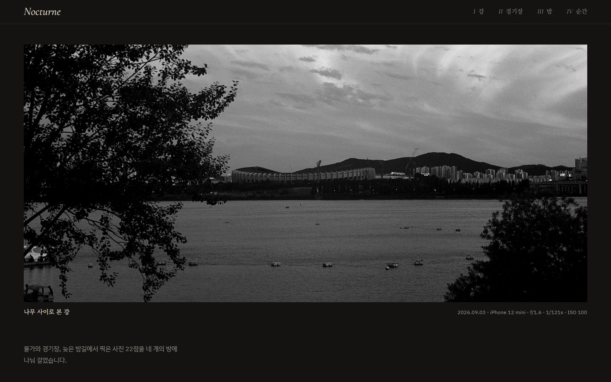
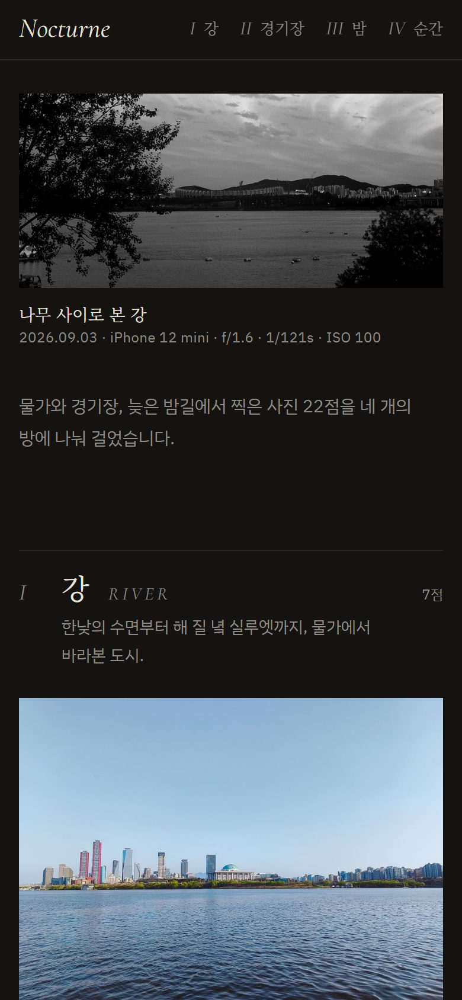
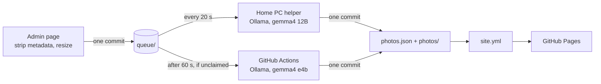
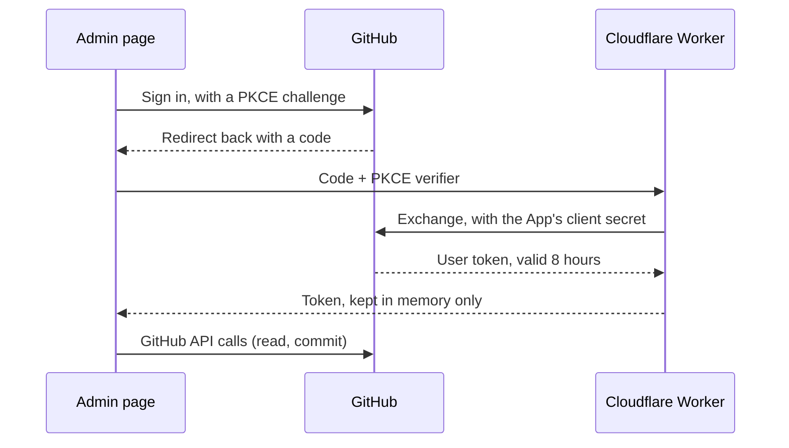

<div align="center">

<picture>
  <source media="(prefers-color-scheme: dark)" srcset=".github/assets/wordmark-dark.png">
  
</picture>

*Photographs hung like a dark exhibition room.*

[](https://github.com/HPotty36/nocturne/actions/workflows/site.yml)
[](https://github.com/HPotty36/nocturne/actions/workflows/draft.yml)
[](LICENSE)
[](#license)

**[Live site](https://hpotty36.github.io/nocturne/)** · **[Admin](https://hpotty36.github.io/nocturne/admin/)** · **[한국어](README.ko.md)**

</div>

<p align="center">
  <picture>
    <source media="(prefers-color-scheme: dark)" srcset=".github/assets/screen-desktop-dark.jpg">
    <source media="(prefers-color-scheme: light)" srcset=".github/assets/screen-desktop-light.jpg">
    
  </picture>
  <picture>
    <source media="(prefers-color-scheme: dark)" srcset=".github/assets/screen-phone-dark.jpg">
    <source media="(prefers-color-scheme: light)" srcset=".github/assets/screen-phone-light.jpg">
    
  </picture>
</p>

Nocturne is a static photo gallery. Upload a photo from a phone or PC, and an open model on Ollama hangs it in the
right room with a title and alt text; the site then rebuilds on GitHub Pages. The repository holds everything: no
database, no paid API.

## Highlights

- **Four rooms**: River, Stadium, Night and Moments, each with its own note and a label under every print.
- **Justified rows**: every row fills the width, and prints keep their own aspect ratio. Nothing is cropped.
- **Viewing room**: click any print to see it large; arrow keys, swipe and Esc work as you expect.
- **Upload and walk away**: pick a photo on any phone or PC. The AI picks the room, writes the title and alt text, and publishes at once. Fix it later if you like.
- **No paid APIs**: Ollama on a home PC (gemma4 12B), or GitHub Actions (gemma4 e4b) when the PC is off. The 12B quietly rewrites e4b's text later.
- **People win**: the AI never changes a title, description or room that a person has edited.
- **Privacy**: metadata is stripped in the browser before upload, and GPS is never read.
- **GitHub login**: a GitHub App with PKCE and a tiny Cloudflare Worker. The token lives in page memory only and is never stored.
- **Light and dark**: follows the system theme. The viewing room stays dark in both.

## How it works

The admin page shrinks the photo, strips its metadata and commits it to `queue/`. Whichever AI claims it first drafts
the room, title and alt text, then publishes everything in one commit. The `site.yml` workflow rebuilds the site.



Signing in to the admin page uses GitHub itself. Only accounts that can write to this repository get in.



## Tech stack

| Part | What it uses |
|:---|:---|
| Frontend | Plain HTML, CSS and JavaScript. The admin page is vanilla ES modules: no framework, no bundler, strict CSP |
| Scripts | Python 3 + Pillow: site build, photo prep, AI worker, home PC helper |
| AI | Ollama with gemma4 12B (home PC) and gemma4 e4b (GitHub Actions) |
| Hosting | GitHub Pages, deployed by GitHub Actions |
| Auth | GitHub App (user tokens, PKCE) + a Cloudflare Worker for the code exchange |
| Tests | Python `unittest` and the Node test runner, with a fake GitHub server |

## Run locally

```sh
py -m pip install -r requirements.txt      # once (Pillow)
py scripts/build.py                        # builds index.html (not committed)
py tests/browser/serve.py --port 8000      # preview at http://localhost:8000
py -m unittest discover -s tests -v        # Python tests
node --test "tests/js/*.test.js"           # JS tests (Node 24)
```

`py` is the Windows Python launcher; use `python3` elsewhere. The tests need no network and no Ollama.
To try the admin page without touching the real repository, run it against the bundled fake GitHub server: see
[CLAUDE.md](CLAUDE.md#관리-페이지를-컴퓨터에서만-시험하기) (in Korean).

## Repository layout

```
src/          page template, and photos.json (rooms, titles, alt text)
photos/       published copies: thumb/ (1000 px) and full/ (2400 px)
queue/        uploads waiting for the AI (only while something waits)
admin/        admin page: upload, review, fix (static ES modules)
auth/         Cloudflare Worker for the login code exchange
scripts/      build, photo prep, AI curator, queue worker, home PC helper
.github/      workflows: site.yml (Pages), draft.yml (AI on Actions); README images
tests/        Python and Node tests, fake GitHub server
docs/         design specs and implementation plans
```

The full project notes (structure, upload flow, login setup, design tokens) are in [CLAUDE.md](CLAUDE.md), in Korean.

## License

The code is released under the [MIT License](LICENSE).

The photographs in `photos/` (and anything under `queue/`) are © HPotty36, all rights reserved. They are not covered
by the MIT License.
